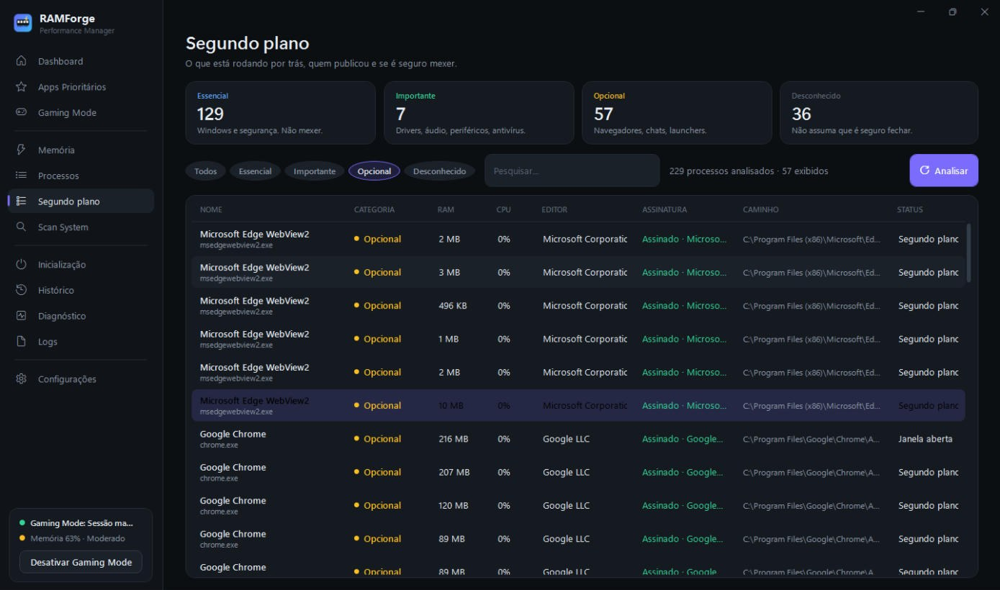

# RAMForge

Gerenciamento inteligente de memória e prioridade de processos no Windows, pensado para jogos. Tudo é reversível.

## Para quem é
Quem joga no PC e quer que o jogo tenha prioridade sobre o resto, sem programas mágicos nem riscos.

## O que faz
- **Estado do PC em tempo real**: memória, processador, placa de vídeo e pressão de memória.
- **Prioridade para o jogo** com um clique, e um clique para desfazer.
- **Gaming Mode**: quando o jogo abre, os apps que atrapalham cedem recursos; quando fecha, tudo volta ao normal.
- **Recomendações** só quando há ganho real.
- **Registro de cada alteração** e botão de emergência para desfazer tudo.
- **Seguro**: nunca mexe nos arquivos ou na memória do jogo, nem em anti-cheat ou processos do Windows.

## Baixar
**[Instalador para Windows (.exe)](downloads/RAMForge-Setup.exe)**

## Telas

---

Este repositório é uma **vitrine** do projeto: mostra o que o programa faz e como ele é. O código-fonte não é público.

Desenvolvido por [@won3er](https://github.com/won3er).